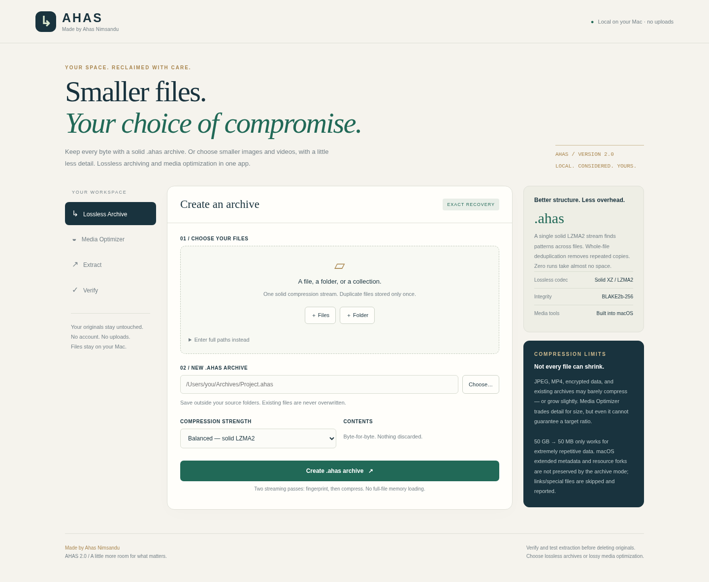
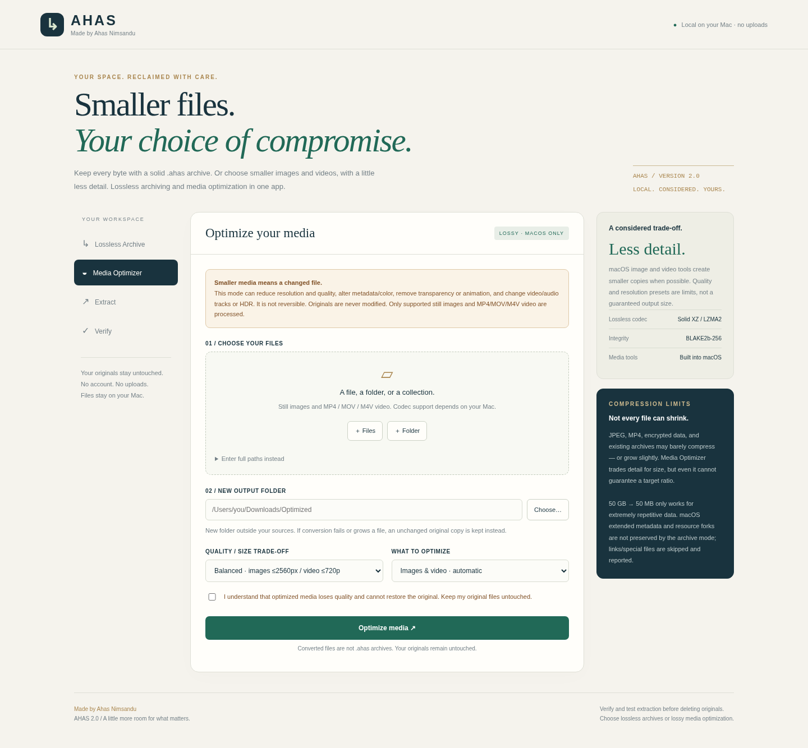

# AHAS 2.0.1

### Space, thoughtfully reclaimed.

**Current native release: [v2.0.1](https://github.com/ahasnimsandu/ahas-compressor/releases/tag/v2.0.1).** Built and launched on an Apple Silicon macOS runner; 61 tests, packaged-app restoration smoke, Apple ad-hoc signature checks, and DMG verification passed. [Actual Mac screenshot](docs/screenshots/native-mac.png).

**Made by Ahas Nimsandu** · Apple Silicon macOS app · MIT-licensed application source

[Repository](https://github.com/ahasnimsandu/ahas-compressor) · [Releases](https://github.com/ahasnimsandu/ahas-compressor/releases) · [Build status](https://github.com/ahasnimsandu/ahas-compressor/actions)

AHAS offers two deliberately separate ways to make files smaller:

| Mode | What it does | Exact recovery? |
|---|---|---|
| **Lossless Archive** | Solid XZ/LZMA2 compression, whole-file deduplication, zero-run elision; creates `.ahas` archives | **Yes**, for supported regular-file bytes |
| **Media Optimizer** | Creates smaller JPEG/MOV copies using macOS image/video tools | **No**; quality, resolution, and other properties may change |



## Install the Mac app

Use the **native-built [GitHub Release](https://github.com/ahasnimsandu/ahas-compressor/releases/latest)** rather than earlier Linux-generated development downloads.

1. Open the Apple Silicon DMG and drag **AHAS.app** into **Applications**, or extract the app ZIP and move **AHAS.app** there.
2. Eject the DMG and open AHAS from Applications.
3. Select Lossless Archive or Media Optimizer. Originals are never overwritten.

The app bundles its own arm64 Python runtime: **no Python, pip, Node, account, or internet connection is needed to run it**. Its interface is hosted in a native AppKit/WebKit window, not an external browser. Logs: `~/Library/Logs/AHAS/app.log`.

**Build target:** Apple Silicon, macOS 11+. **Release status:** experimental, ad-hoc signed only; **not Developer ID signed or notarized**. The published v2.0.1 DMG and ZIP were built and launched on an actual Apple Silicon macOS runner. All 61 tests, Apple ad-hoc code-signature checks, bundled-runtime imports, DMG verification, and a packaged-app archive/restore round trip passed. Full GUI/file-dialog, all-codec video, minimum-OS, and end-user Gatekeeper testing remain separate. See [validation](VALIDATION.md).

If macOS blocks or labels a download “damaged,” do not assume the file is safe or disable security globally. Check its checksum, use the native macOS build workflow, and investigate Apple's `codesign`/Gatekeeper output. A regular **Privacy & Security → Open Anyway** approval may be offered for a trusted unnotarized app, but it does not repair an invalid signature or corrupted disk image.

## What's new — actual compression changes

Version 1 compressed each 4 MiB chunk separately and stored it in SQLite. That incurred a database overhead and limited cross-chunk compression. **AHAS v2 changes the format**, not just the extension:

- One **solid LZMA2/XZ stream** shares a dictionary across entries.
- Identical complete files are stored once, regardless of file size. Extraction creates ordinary separate copies.
- All-zero blocks become short length records, not compressed payloads.
- Compact framed metadata replaces the SQLite container.
- Each file's bytes are checked with **BLAKE2b-256** on extraction/verification.
- Existing `.cla` archives remain readable for extraction and verification.

Files are fingerprinted in a first streaming pass and packed in a second. Memory does not scale with the largest file, but manifests scale with file count. Fast uses LZMA preset 1; Balanced uses 6; Maximum uses 9 plus EXTREME and can need roughly **700 MiB RAM** and substantially more CPU. Balanced is the default.

**Trade-off:** v2 deduplicates entire files, not arbitrary matching chunks of different files. Solid compression catches nearby patterns within its dictionary; it is not always better than v1 or other tools on partial-duplicate datasets.

### Measured examples

Deterministic, selected synthetic tests; all new archives were verified. Balanced v2 versus legacy v1 and ZIP/DEFLATE-6:

| Dataset | Input | Legacy `.cla` | New `.ahas` | ZIP |
|---|---:|---:|---:|---:|
| Repetitive text | 6,300,000 B | 36,864 B | **1,384 B** | 18,554 B |
| 150 small text files | 301,840 B | 98,304 B | **12,036 B** | 32,612 B |
| 16 identical binary files | 16 MiB | 1,085,440 B | **1,049,388 B** | 16,784,534 B |
| Zero-filled file | 64 MiB | 36,864 B | **336 B** | 65,372 B |
| Unique random bytes | 8 MiB | 8,433,664 B | **8,389,480 B** | 8,391,314 B |

These are **not universal performance claims**. Codec settings, container overhead, and workload selection all matter. Random and already-compressed data can still grow slightly; ZIP was substantially faster on random data. This combines established methods rather than inventing a new codec. No claim is made to beat all 7-Zip/Zstandard/backup tools. See [raw results](benchmark-results.json) and `python3 benchmark.py`.

**50 GB → 50 MB?** Only for extremely redundant data. No lossless format can guarantee this for arbitrary inputs. A full 50 GB run has not been tested in this environment.

## Choose the right mode

### Lossless Archive

Use for documents, source code, logs, datasets, duplicate files, or anything whose exact regular-file bytes must be recoverable. Save a new `.ahas` file **outside** selected source folders. Use **Verify**, then test **Extract** into a new folder before deleting originals. Small archives and compressed formats can grow; the app reports that honestly.

- Preserves: regular-file content bytes, directory structure, empty folders/files, basic permission bits, and modification timestamps when the filesystem supports them.
- Does not preserve: resource forks, extended attributes, Finder tags, ACLs, owners/groups, creation dates, hard-link identity, or APFS clone identity.
- Symbolic links and special files are skipped and reported. Overlapping roots/case-normalized name conflicts may be rejected.
- Not a complete Mac system backup tool; apps/data relying on extended metadata may not function identically after restore.
- No encryption, password protection, signing/authentication, recovery records, or ZIP/RAR/7z interoperability.
- Hashes detect content corruption, not malicious modification by an attacker who can rewrite hashes. Extract only archives you trust.

### Media Optimizer — explicitly lossy



Requires checking the **quality-loss consent** box. Select **Images & video**, **Still images only**, or **Videos only**.

| Profile | Still-image output | Video preset ceiling |
|---|---|---|
| Smallest | JPEG quality 55, maximum dimension 1600 px | 640×480, or available low-quality fallback |
| Balanced | JPEG quality 72, maximum dimension 2560 px | 1280×720, or available medium-quality fallback |
| More detail | JPEG quality 85, maximum dimension 3840 px | 1920×1080, or available high-quality fallback |

- Still-image input: JPEG, PNG, TIFF, HEIC/HEIF, BMP, subject to the Mac's `sips` support. Output is JPEG; transparency, animation, metadata/color, or extra image content may be lost. HEIC can already be smaller than JPEG.
- Video input containers: MP4, MOV, M4V. Codec/DRM support depends on `avconvert` and macOS. Output is MOV; tracks, resolution, quality, metadata, HDR, and audio can change. Only supported presets reported by that Mac are used. Audio-only files and MKV are not supported by this release.
- Quality/resolution presets are not output-size targets and do not guarantee a reduction.
- New files go in a **new output folder outside sources**. If conversion fails or is not smaller, the output folder receives an unchanged original copy and a report explains why. Source files are never modified.
- The mode uses `/usr/bin/sips` and `/usr/bin/avconvert`, not bundled ffmpeg or external downloads. It does not work in a Linux hosted preview.

## Privacy, safety, and resources

The app binds a random **127.0.0.1-only** port. Its self-contained UI has no CDN assets, telemetry, account, or upload service. API calls use a per-process random token plus Host/Origin checks; it is not a multi-user authenticated service. Anyone with access to the same desktop may be able to use it. `--preview` is only for a hosted sandbox demo and intentionally exposes a preview port; do not use that flag on your Mac.

Originals are not overwritten. Existing archive/extraction/media outputs are not overwritten. Controlled cancellation/failure removes incomplete output; forced termination, power loss, or disk errors can leave partial files/folders. Do not treat active/changing files as a consistent snapshot. Extraction defaults to a 1,024 GiB logical-size cap and conservatively checks free space; change the cap if needed. Archive output publication needs a local filesystem with hard-link support, e.g. APFS; FAT/exFAT and cloud/network targets are not supported for new archives.

Keep independent backups. A damaged shared/solid payload may affect multiple files. Solid archives are sequential: no random-access preview or selective extraction UI is included.

## Run from source / command line

Python 3.11+; no pip packages required for the application itself:

```sh
python3 -m compactlocal
python3 -m compactlocal compress "/path/to/Project" -o "/path/to/Archives/Project.ahas" --level 6
python3 -m compactlocal verify "/path/to/Archives/Project.ahas" --max-gb 100
python3 -m compactlocal extract "/path/to/Archives/Project.ahas" -o "/path/to/Restored" --max-gb 100
# macOS only; explicit irreversible-quality-loss acknowledgement:
python3 -m compactlocal media "/path/to/Photos" -o "/path/to/Optimized" --profile balanced --accept-lossy
```

Alternatively, double-click `Start AHAS.command` after installing a suitable Python. The source launcher opens your browser; the packaged `.app` uses its native window. `--max-gb` uses GiB. CLI results are JSON.

## Test and build

```sh
python3 -m unittest discover -s tests -v
python3 benchmark.py > benchmark-results.json
# Optional browser-development tests (Node needed only for these):
npm install
npx playwright install chromium
npm run test:browser
# On a Mac with Python + Xcode Command Line Tools:
bash macos/build-on-mac.sh
```

The Mac build downloads a pinned, checksum-verified runtime, installs build-only Pillow/ds_store in a temporary venv, produces an ad-hoc app/DMG/ZIP, runs Apple's code-signature checks, and verifies the DMG. This does not grant Developer ID trust or notarization. Check the repository Actions page for the current native-Mac release-build result; a passing build still does not replace manual GUI testing. See [build notes](macos/BUILD-NOTES.md), [format](docs/FORMAT.md), [validation](VALIDATION.md), and [security policy](SECURITY.md).

## Publish to GitHub

The source folder is repository-ready, with CI, release packaging, tests, documentation, and a license. The public upstream repository is **ahasnimsandu/ahas-compressor**. To publish a separate fork/copy under your account, run `Publish to GitHub.command` on your Mac to authenticate using GitHub CLI and choose visibility. It can optionally start a native Mac release build. Details: [GitHub publishing guide](docs/GITHUB.md).

Made by **Ahas Nimsandu**. Application source: MIT. Bundled runtime components keep their own licenses; provenance and license documents are under `macos/` and inside the app.
